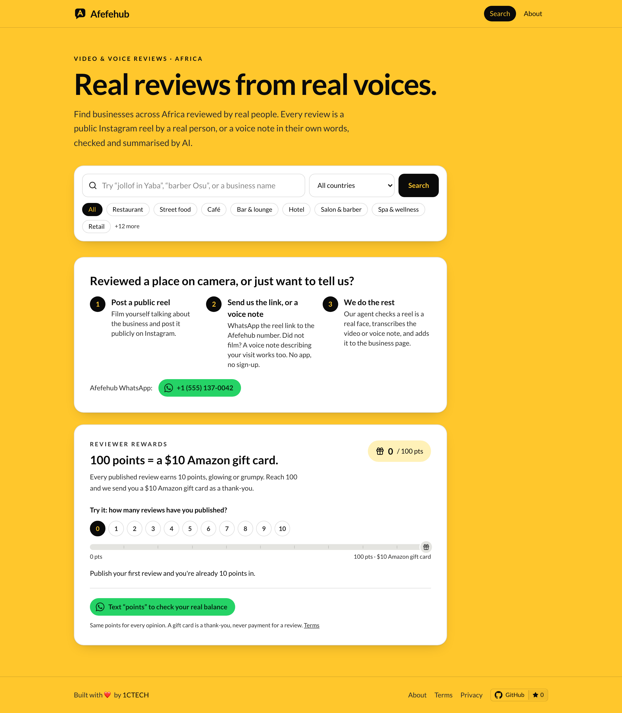
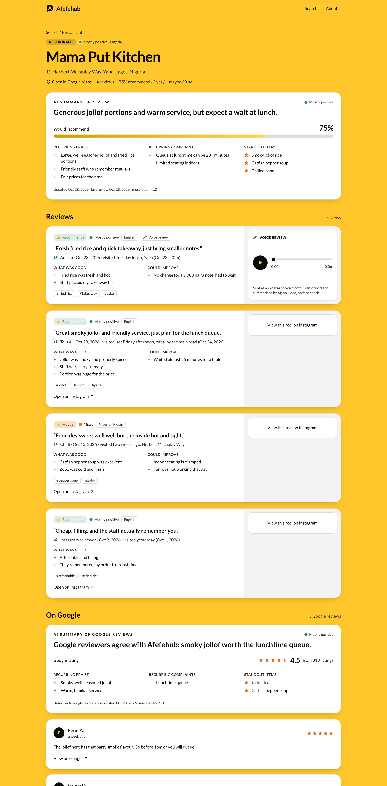
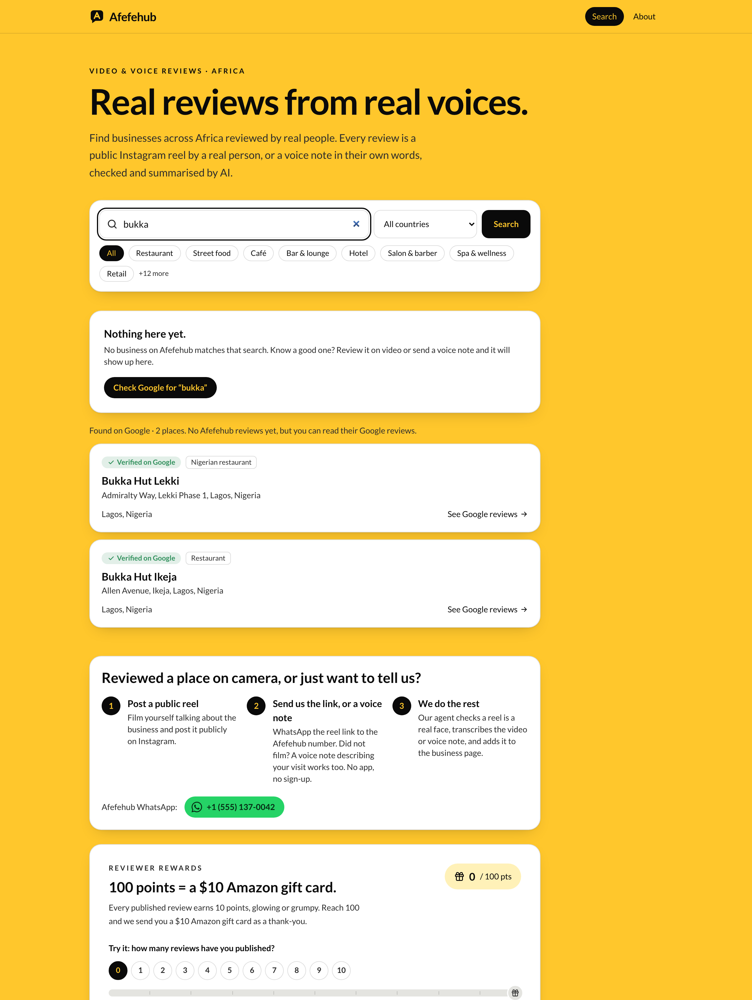
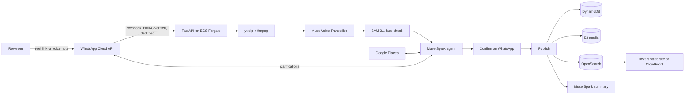

<p align="center">
  
</p>

<p align="center">
  <a href="https://github.com/victorlenerd/osaf/actions/workflows/ci.yml"></a>
  <a href="LICENSE"></a>
  <a href="https://afefehub.com"></a>
  <a href="https://dev.meta.ai/events/global-hackathon"></a>
</p>

# Afefehub

**Real reviews from real voices.** Afefehub turns public Instagram video reviews and WhatsApp
voice-note reviews into a searchable, continuously updated history of businesses across Africa.
Every review is a real person talking about a real visit, verified and structured by Meta's
models, and every business gets a living AI summary that is regenerated after each new review.

Built for the [Meta Global AI Developer Hackathon](https://dev.meta.ai/events/global-hackathon)
(October 2026, theme *Build for Your World*, startup track). Open source under the MIT license.
**Live in production at [afefehub.com](https://afefehub.com)**, API at `api.afefehub.com`.



## Try it in 60 seconds

1. Open [afefehub.com](https://afefehub.com) and search for a business, a dish or a neighbourhood.
   If Afefehub has nothing yet, press **Check Google** to see the Google listing and an AI
   summary of its Google reviews.
2. To submit a review, WhatsApp the number shown on the home page: send a link to a public
   Instagram reel of you reviewing a place, **or just send a voice note** describing your visit.
   No app, no account. The agent transcribes it, asks at most three short questions if something
   is missing, shows you the structured review, and publishes it when you reply "OK".
3. Text **points** to the same number to see your reviewer balance.

The public API needs no key:

```bash
curl "https://api.afefehub.com/api/search?q=jollof"
```

## The problem

Online reviews are easy to fake and hard to trust, and for most African businesses there are
barely any. Short video reviews already exist on Instagram, but they are scattered, unsearchable
and unverifiable. The business being talked about often has no Google listing at all.

- In Africa, **85.8% of employment is informal** ([ILO, *Women and men in the informal economy*, 2018](https://www.ilo.org/resource/news/more-60-cent-world%E2%80%99s-employed-population-are-informal-economy)).
  Those are the food stalls, barbers, tailors and mechanics that a star-rating platform never reaches.
- SMEs are about **90% of businesses and more than half of employment** worldwide
  ([World Bank](https://www.worldbank.org/en/topic/smefinance)), yet discovery tools are built for the
  formal, listed minority.
- Reviews move real money: the UK regulator estimates **£23 billion a year** of consumer spending is
  potentially influenced by online reviews
  ([CMA](https://www.gov.uk/government/news/amazon-gives-undertakings-to-cma-to-curb-fake-reviews)),
  and the US FTC had to ban fake and AI-generated reviews outright in 2024
  ([FTC final rule, 14 Aug 2024](https://www.ftc.gov/news-events/news/press-releases/2024/08/federal-trade-commission-announces-final-rule-banning-fake-reviews-testimonials)).
- The raw material is already there. Nigeria alone has **107 million internet users** and an
  Instagram ad audience of 9.9 million; Kenya has 27.4 million internet users
  ([DataReportal, Digital 2025](https://datareportal.com/reports/digital-2025-nigeria)). WhatsApp is
  the default channel for both consumers and small businesses across the continent.

Afefehub's bet: a review that is a **public video of a real face**, or a **voice note in the
reviewer's own words**, is far harder to fake than a star rating, and an AI agent can turn that
unstructured speech into a searchable record that works for businesses Google has never heard of.

## What Afefehub does

| | |
|---|---|
| **Reel reviews** | The reviewer posts a public Instagram reel and WhatsApps the link. The reel is downloaded, transcribed, checked for a real talking face, structured, confirmed with the reviewer and published with the reel embedded. |
| **Voice-note reviews** | Did not film? Send a WhatsApp voice note. Same pipeline minus the face check; the recording is transcoded and plays on the business page, badged **Voice review** so readers can tell the two apart. |
| **Multilingual** | Reviews in Nigerian Pidgin, Yoruba, Igbo, Hausa, Swahili, French, Arabic, Twi and more are understood as spoken; fields are written in plain English and the business name is kept verbatim as said. |
| **Businesses Google does not know** | If Google Places has no match after two searches, the agent creates a user-sourced `afefe:<slug>` business from the reviewer's words. Informal businesses get a page on day one. |
| **Living summary** | After every published review, Muse Spark regenerates the business's summary: headline, recurring praise, recurring complaints, standout dishes or services. Counts and recommend rate are computed in code, never by the model. |
| **Search** | Typeahead over business names *and the names reviewers actually said*, keywords, address and city, with fuzzy matching and a boost for well-reviewed, well-recommended businesses. Filter by 13 countries and 20 categories. |
| **Google fallback** | Empty result? One tap checks Google Places and shows the listing with an AI summary of up to five live Google reviews (attributed, never stored). |
| **Reviewer rewards** | 10 points per published review, glowing or grumpy; 100 points earns a US$10 Amazon gift card. Capped at 3 reviews per reviewer per rolling week. A thank-you, never payment for a particular opinion. |

<p align="center">
  
  
</p>

## How Meta's models are used

One API key, one base URL (`https://api.meta.ai/v1`), one client (`backend/app/meta/client.py`).

| Step | Model | What it does |
|---|---|---|
| Transcribe | `muse-voice-transcribe-1.0` | Diarized speech-to-text (`mode=DIARIZATION`) with a language bias list and **keyword biasing**: when the reviewer answers a question by voice, the candidate business names are passed as ASR keywords so "number two" and misheard names resolve correctly. |
| Verify | `sam-3.1` | Text-prompted detection and tracking of *"a person's face"* across the reel. The clip is re-encoded at about 2 fps to stay inside SAM's 50–1500 frame window. **Pass rule:** a confident face track in at least 50% of frames **and** one diarized speaker holding at least 60% of the speech. Screen recordings, slideshows and voice-overs fail. Reels only; voice notes skip this step and are badged. |
| Understand | `muse-spark-1.3` | A tool-calling agent with four tools: `search_places` (Google Places API New), `ask_user`, `finalize_review` and `reject_review`. It resolves the business, extracts visit time and place, what was good, what to improve, recommend yes/no/maybe, category and keywords, and asks the reviewer on WhatsApp only when the recording is not enough. |
| Summarize | `muse-spark-1.3` | JSON-mode summaries for each business and for Google-only listings, with `reasoning_effort="minimal"`. Measured on this task: default reasoning spent about 5k tokens and 35 s; minimal takes about 5 s with the same quality. |

**Agent guardrails, enforced in code rather than in the prompt** (`backend/app/agent/extract.py`):

- A `place_id` must come from a real `search_places` result; an invented one is rejected and the
  agent gets one retry. A user-sourced business is only allowed after two failed searches.
- Business confidence must be at least 0.7; everything else degrades gracefully (`recommend: maybe`, empty lists).
- At most 3 clarification rounds. At zero, `ask_user` is removed from the tool list, so the model
  must finalize or reject. At most 8 iterations and 4 searches per turn.
- `reject_review` filters vlogs, skits, unboxings and rants: Afefehub only publishes spoken reviews of a real visit.
- The agent is **stateless per WhatsApp turn**: the transcript, fields so far, Q&A log and the last
  candidates shown are rebuilt from DynamoDB each time, so a deploy mid-conversation loses nothing.

## Architecture



Submission state machine (one active submission per phone, re-runnable from any transient state):

```
NEW → DOWNLOADING → TRANSCRIBING → VERIFYING → EXTRACTING ⇄ AWAITING_CLARIFICATION → CONFIRMING → PUBLISHED
any stage → REJECTED · a new link ABANDONs the old one · failed download → AWAITING_VIDEO (reviewer sends the file on WhatsApp)
no model key → PAUSED (media kept, resumes later) · voice notes skip VERIFYING
```

| Layer | What |
|---|---|
| **Backend** | FastAPI, Python 3.12+. WhatsApp webhook, pipeline, agent, public API. Runs as one container on ECS Fargate behind an ALB. |
| **Data** | DynamoDB single table (conversations, submissions, dedupe locks, businesses, reviews, summaries, points) with conditional writes for idempotency. S3 for media and agent traces. OpenSearch for search. |
| **Search** | Edge-ngram (2–15) with ASCII folding on `name` and `names_as_said`; fuzzy `multi_match` boosted `name^4`, `names_as_said^3`, `keywords^2`; score × `log1p(review_count) × (0.5 + recommend_rate)`. |
| **Frontend** | Next.js 15 static export, React 19, Tailwind 4. Three runtime dependencies. No cookies, no analytics. Served from S3 through CloudFront (PriceClass_200, chosen to include African edge locations). |
| **Infra** | Terraform: Route53, ACM, CloudFront + S3, ALB + ECS Fargate, DynamoDB, OpenSearch, ECR, SSM Parameter Store, **AWS WAF**. Remote state in S3 with locking. |
| **Cost** | About US$60/month at idle (OpenSearch t3.small ≈ $26, ALB ≈ $18, one Fargate task ≈ $15, the rest pennies). |

Full detail in [`docs/ARCHITECTURE.md`](docs/ARCHITECTURE.md).

## Production readiness

Afefehub has been live in production since 2026-10-29. What holds it up:

- **Fail-closed secrets.** With `ENV=prod` the app refuses to start unless every required secret is
  set and not a placeholder. Webhooks without a valid `X-Hub-Signature-256` are rejected everywhere
  except `ENV=dev`, compared in constant time.
- **Privacy by construction.** Reviews store an HMAC-SHA256 keyed hash of the reviewer's phone,
  never the number. A root-logger filter redacts anything shaped like a phone number; the verify
  token is scrubbed from access logs. The public API never returns the hash. Media under
  `submissions/` expires after 30 days; submissions carry a 7-day TTL; logs are kept 14 days.
  The site sets no cookies and runs no analytics.
- **Hardened container.** Non-root user, read-only root filesystem with a single writable `/tmp`,
  all Linux capabilities dropped, 30 GiB bounded scratch disk. Reels over 15 minutes or 500 MB are
  refused before download; voice notes over 10 minutes are refused.
- **Edge protection.** AWS WAF on the ALB: per-IP rate limits on the paid endpoints
  (`/api/places/*`, which call Google and Muse Spark) and on `/api/*`, plus the AWS Common Rule Set
  and IP reputation list. A per-process token bucket backs it up in the app.
- **Least privilege.** The task role gets exactly the DynamoDB item operations the app uses (no
  Scan), object access on the media bucket, and signed OpenSearch HTTP. Secrets are injected by the
  execution role from SSM SecureString; the app never reads SSM at runtime.
- **Idempotency everywhere.** Webhook message ids are claimed with a conditional put; one review
  per reel shortcode; business counters use atomic `ADD`; S3 keys are deterministic; points are
  awarded only after the PUBLISHED write is durable.
- **Abuse limits.** 3 published reviews per reviewer per rolling 7 days; SAM face and
  dominant-speaker check; `reject_review` for non-reviews; Google reviews shown live and never stored
  (Places API terms).
- **Transport.** TLS 1.2+ on CloudFront, TLS 1.3 policy on the ALB, HTTP→HTTPS redirect,
  OAC-only site bucket, private media bucket with one-hour presigned URLs for voice playback.
- **Tests and CI.** 68 test cases across webhook routing, quota, points, voice paths, publishing,
  the agent's tool loops, SAM frame parsing, Google Places and the hardening rules, all against
  scripted fakes with no live model calls. CI runs ruff, pytest, eslint and `next build` on every
  push and pull request.
- **Operability.** ECS deployment circuit breaker with rollback, ECR scan on push, DynamoDB
  point-in-time recovery, OpenSearch encrypted at rest and in transit, a `/healthz` probe, a
  per-turn agent trace in S3 for every submission.

The honest list of what is still open (moderation queue, SQS worker, autoscaling, reviewer deletion
script, staging environment) is in [`docs/PRODUCTION_CHECKLIST.md`](docs/PRODUCTION_CHECKLIST.md).

## Business model

**Who it serves**

- **Reviewers** get a home for the reviews they already film, in their own language, with points
  towards a gift card and a country flag on every review.
- **Businesses**, including ones with no Google listing, get a public page with verified video and
  voice reviews and a summary that tells them exactly what customers praise and complain about.
- **Customers** get reviews they can look in the eye instead of anonymous stars.

**How it makes money (roadmap, nothing is paid today)**

1. Verified business profiles: claim the page, reply to reviews, add hours, menu and WhatsApp
   ordering.
2. Insights for businesses: the running summary and keyword trends as a monthly report.
3. API access for food delivery, maps and fintech platforms that want verified reviews for
   informal merchants.
4. Concierge onboarding for business associations and markets that want their traders listed.

**Integrity rules.** Same points for every opinion, positive or negative. The gift card is a
thank-you, never payment for a particular review. Reviews are public reels or voice notes; nothing
is typed in. The terms, privacy policy and operator (1CTECH, Ontario, Canada) are published on the
site.

## Roadmap

- Content moderation pass (Muse Spark classification) with a `HELD` state and a human queue before
  anything goes public.
- Move the pipeline out of the web worker into an SQS queue and a worker service; add autoscaling
  and a second task across AZs.
- Reviewer self-service: opt out of the display name, delete my data, all over WhatsApp.
- Business claiming and replies.
- Keep the "send the file on WhatsApp" fallback first-class, since Instagram downloads can break.
- Staging environment and deploys from GitHub Actions with OIDC.

## Repository

| Path | What |
|---|---|
| `backend/` | FastAPI service: WhatsApp webhook, pipeline, Muse Spark agent, public API, tests |
| `backend/scripts/` | `run_pipeline_local.py` (run the Meta pipeline on one reel or voice note), `seed_demo.py` (fictional demo businesses), `create_index.py` |
| `frontend/` | Next.js static site (search, business pages, about, terms, privacy) and a zero-dependency mock API |
| `infra/terraform/` | AWS: Route53, ACM, S3 + CloudFront, ECS Fargate + ALB, DynamoDB, OpenSearch, ECR, SSM, WAF |
| `scripts/` | `deploy_backend.sh` (build, push by git SHA, roll ECS), `set_secrets.sh` (SSM secrets) |
| `brand/` | Logo sources and exported marks, lockups, social and app icons |
| `docs/` | Architecture, production checklist, screenshots |

## Running the backend locally

```bash
cd backend
python3 -m venv .venv && . .venv/bin/activate
pip install -e ".[dev]"
cp ../.env.example .env   # fill in MODEL_API_KEY, GOOGLE_PLACES_API_KEY, WhatsApp settings
pytest
uvicorn app.main:app --reload
```

Try the Meta pipeline without WhatsApp, on a reel or a voice note:

```bash
python scripts/run_pipeline_local.py https://www.instagram.com/reel/XXXXXXXX/ --extract
```

```bash
python scripts/run_pipeline_local.py --voice note.ogg --extract
```

Expose the webhook for WhatsApp during development with a tunnel (for example
`cloudflared tunnel --url http://localhost:8000`) and register `https://<tunnel>/webhooks/whatsapp`
with your `WHATSAPP_VERIFY_TOKEN` in the Meta app. From the repository root, `make test`, `make lint`
and `make run` wrap the same commands.

## Running the frontend locally

```bash
cd frontend
pnpm install
pnpm mock   # fixture API on :8000, no keys needed
pnpm dev    # site on :3000
```

The mock serves the full API contract, including the Google fallback and a seekable voice note, and
simulates errors (search `busy` for a 429, `nokey` for a 503). See
[`frontend/README.md`](frontend/README.md) for the build and deployment.

## Configuration

All settings are environment variables; see [`.env.example`](.env.example). Secrets are never
committed. In AWS they live in SSM Parameter Store under `/afefehub/prod/` and are injected into
the ECS task.

With `ENV=prod` the backend refuses to start unless every required secret is set (`MODEL_API_KEY`,
`META_APP_SECRET`, `WHATSAPP_ACCESS_TOKEN`, `WHATSAPP_PHONE_NUMBER_ID`, `WHATSAPP_VERIFY_TOKEN`,
`PHONE_HASH_SALT`), so set them with `scripts/set_secrets.sh` **before** rolling a new image.
Deploy with `scripts/deploy_backend.sh`; infrastructure with `make infra-plan` and `make infra-apply`
(see [`infra/terraform/README.md`](infra/terraform/README.md)).

## Team

Built by Victor Nwaokocha and operated by 1CTECH (Ontario, Canada). Afefehub was built for the Meta
Global AI Developer Hackathon under the *Build for Your World* theme: a problem the author knows
firsthand, solved with Meta's models for the businesses and reviewers who are already on Instagram
and WhatsApp.

## Contributing

Issues and pull requests are welcome. Start with [CONTRIBUTING.md](CONTRIBUTING.md); security
reports go through [SECURITY.md](SECURITY.md), not public issues. Everyone taking part is expected
to follow the [code of conduct](CODE_OF_CONDUCT.md).

## License

MIT, see [LICENSE](LICENSE).
